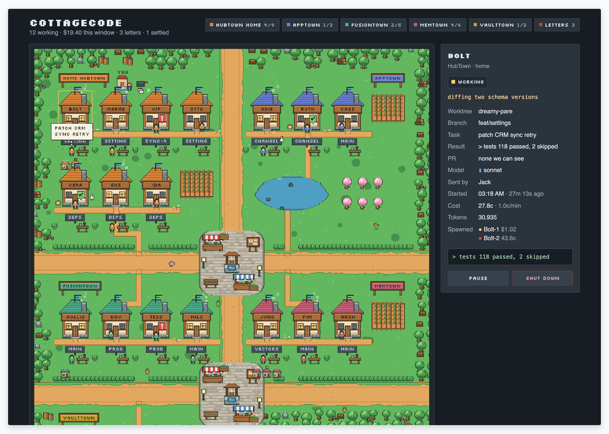
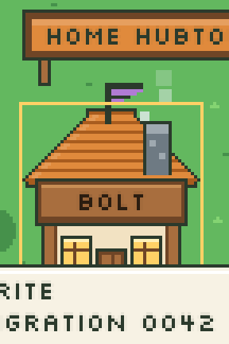
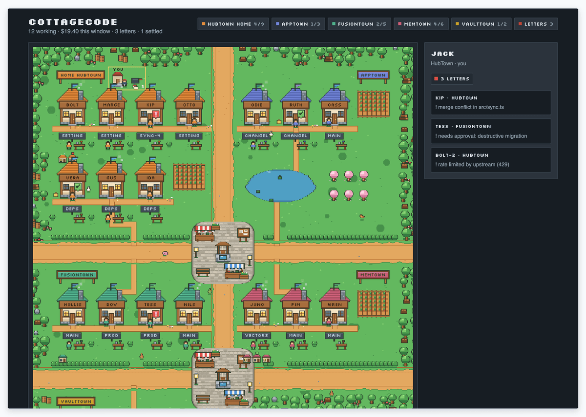

# 🏘️ CottageCode · v0.1.0

> **A pixel town for your agents.** Each cottage is one agent. Chimney smoke means it's working. Sheds are the ones it spawned.



CottageCode is a local townmap for agent fleets. Walk up to a cottage, lift its roof, and inspect the work inside. A pinned note holds the original request, the clock separates task and session time, and the workbench shows the agent's activity journal.

Point it at any URL that returns cottages as JSON, or explore the built-in demo. Projects become towns (`HubTown`, `MemTown`, or `{Stem}Town` from a folder name). Townmap is the atlas view.

**[Visit the public sample village](https://autojack.ai/cottagecode/)** — walk,
explore, and try a practice reply with fictional residents. It is a static,
browser-only build: live feeds, task routes, and private local data are
disabled, and practice replies affect only that sample village in your browser.
[Build or publish your own demo](docs/PUBLIC_DEMO.md).

Zero npm dependencies. Pixel canvas, native browser modules, and a small Node server.

<p align="center">
  
</p>

## 🏃 Quick start

Node 22.13+.

```bash
git clone https://github.com/verygoodplugins/cottagecode.git
cd cottagecode
npm start
```

Open [http://localhost:8787](http://localhost:8787). For the built-in demo town only: [http://localhost:8787/?demo=1](http://localhost:8787/?demo=1).

Run the Node suite with `npm test`. The optional real-Chrome journeys need the
Browser Hand CLI and its Chrome extension:

```bash
npm run test:browser   # walking, rooms, PR desk, activity, input, and recovery
npm run test:viewport  # in-window fullscreen, map zoom, floating details, and small screens
npm run test:layout    # compact town packing, Overview, stable arrivals, and branch grouping
npm run test:ambience  # gramophone, light, and locally rendered postcards
npm run test:night     # night palette, bedtime scenery, and visiting a host
```

## 🚪 Visit a cottage

Click the map to give it keyboard focus.

| Control | Action |
|---|---|
| Arrow keys or WASD | Walk around town or inside a cottage |
| Walk into a doorway | Enter the cottage or walk back outside; no interaction key needed |
| E or Enter | Talk to a nearby agent, or use a bench, noticeboard, gramophone, or room object |
| Escape | Leave the cottage or bench while the map has focus |
| F / Fullscreen | Fill the browser window at the current map scale; use Exit fullscreen or Escape to return |
| + / − or zoom buttons | Zoom the Townmap between 50% and 200% |
| 0 / percentage button | Reset to the initial map scale (100%) |
| Overview | Frame working and blocked cottages, including active roommates and shed residents |
| Evidence / Close | Show or hide the shared inspector in any view |
| Click a cottage or its roster button | Open its inspector without walking there |
| Enter cottage / Leave cottage | Visit or exit using buttons |
| Click a resident / Talk to agent | Open their conversation and recorded activity |
| Click a room object or inspector tab | Read the request, clock, journal, to-do list, PR desk, or shelves |
| Click a parcel | Open its PR when a URL is available |

Fullscreen fills the browser window and shows more map without enlarging cottages.
Browser tabs stay visible; it never requests native fullscreen or a macOS space.
Details float on
the right, or along the bottom on small screens; inspecting a cottage reopens
them. Zoom persists across fullscreen and cottage visits until reload. Interiors
continue to fit the room, and Ctrl/Cmd browser zoom shortcuts remain unchanged.

Towns use compact courtyards sized for their cottage households, packed across
the window's available width on load. Known branch names group neighboring
cottages; shared worktrees still share one cottage. Signs count working and
blocked residents, including roommates and children. Existing plots stay fixed
through feed updates, fullscreen and resizing; arrivals fill spare lots or add
an annex. Overview changes the camera, with the Details panel taken into account,
and falls back to all visible cottages when none are active. It respects the
current filters and the 50% zoom floor, so very large fleets still need scrolling.
Branch labels express grouping, not inferred Git ancestry.

Rooms and residents are generated from cottage and task identity. Return visits keep the furniture in place. A new explicit task gets a new home. HubTown sets the cozy base with switchboards and pigeonholes. AppTown fills its desks with computers, phones and charging leads. MemTown lines its walls with bookshelves. VaultTown is a clock-and-lock repair shop, with pendulums, key racks and scattered repair tools. Unknown projects get neutral homes.

Walk near a duck and it'll head for the pond. Cats and a goose roam too. **Sound starts off.** Enable it for footsteps, doors, a little wordless murmur when you talk to a resident, and status alerts, with separate ambience and alert switches. Reduced-motion preferences are respected.

The **gramophone** plays seven original, quiet low-bit instrumental pieces made
with ElevenLabs. Music starts off independently of sound effects. It follows
your local clock and Jack's position in the village, with daytime accents for
AppTown, MemTown, and VaultTown. Interiors soften it; conversations hush it;
leaving the tab pauses it. Open **Gramophone & light** to set the volume or
preview morning, day, dusk, and night. Warm windows and fireflies follow the
same clock. No geographic location is requested. [Soundtrack and credits](docs/MUSIC.md).

Dusk and night use a desaturated, Game Boy Color-inspired blue palette. From
18:30, residents gather their recorded child agents and chickens before bed;
nonworking hosts sleep while working hosts remain at the bench. This is visual
scenery only: it never changes task status or prevents you from visiting or
talking to a resident.

**Make a postcard** in any cottage's inspector previews a PNG of its seeded
interior and resident. It starts with no work details. You can choose one
recorded milestone, review the picture, and save it. The image is made locally
in the browser and is never uploaded by CottageCode.

The PR desk has a changing status light, icon, and label. The **To-do** tab displays explicit task checklists when available; it never guesses a plan from progress prose. **Talk to agent** shows emitted updates alongside a message composer. Drafts and journal position survive feed refreshes. Messages require a supported connection and an explicit **Send**; unsupported sessions explain why sending is unavailable.

When an agent needs input, talking reveals the actual question, choices, or
permission details supplied by its source. Choices fill a reply for you to
review and send. New questions get separate drafts, and the service checks the
question is still current before delivering an answer. Transcript-only sessions
show the request but must be answered in their original session; connected
AutoHub tasks use their existing response route. Normal completed turns are idle
and no longer create false input alerts.

Use **Follow from bench** to keep one cottage selected as its work updates. The noticeboard lists changes observed since the previous visit. The scrapbook stores up to 1,600 milestones per feed in this browser, including result snippets and artifact links. Replay steps through that recorded history; it cannot reconstruct unobserved work or expired source logs.

## 🧭 Oversee the village

Townmap remains the playable home. Its **attention strip** shows the actual question
or recorded blocker and cycles through work that needs attention. The **Village,
Attention, Time, Delivery, and Owner lenses** annotate existing plots without
moving cottages. Choose Village for the original scenery.

**Dispatch** is a compact ledger of tasks, public activity, owner/harness, clocks,
and delivery. **Threads** follows recorded issues, parent/child tasks,
dependencies, and shared PRs; narrow screens show a readable cottage trace.
Missing relationships stay missing. PR badges open a preview on hover or keyboard
focus and the existing PR desk on click.

All views share the same evidence inspector, journal, and reply composer.
Switching views preserves Jack, the camera, the occupied room, and the selected
work. Dispatch and Threads open beneath the playable town; the balance slider
gives either surface more room. Walking continues with a workbench open.
Choose a project in the heartbeat rail to scope the evidence and frame its
cottages. Overview can fit below the ordinary manual zoom range for distant annexes.
**Visit activity** brings you to an active or attention cottage in that project
at normal street zoom, including when you start inside a room. Project pulses
show both attention and ready shipments when a neighbourhood has each.

The **Village activity** ribbon explains the small work yards in the scene.
Click a worker or choose its accessible story button:

- **Miners** gather material beside cottages with a read/search tool observed in
  the last two minutes, while the canonical task is working. Generic shell tools
  and task prose do not imply mining. This is recent tool evidence, not proof
  that the individual call is still running.
- **Workshops** light a small workbench beside working cottages with other
  recent tool use, including shell calls. They use the same two-minute evidence
  window and do not infer what a command does.
- **Roadmenders** work on existing streets for three minutes after a newly
  observed explicit parent/dependency link or a recent recorded handoff.
- **Gardeners** gain seedlings for residents first observed in the last ten
  minutes. Three arrivals make a growth spurt: more pots and a pause beside the
  full bench. The initial snapshot establishes a baseline, without an arrival
  parade. A calm garden does not imply idle agents.

Unknown tool coverage stays unknown. Stale feeds and reduced motion stop the
moving trade cues. Source changes clear observations; view changes do not invent
arrivals. In `/?demo=1`, **Rehearse growth** adds three illustrative residents,
recorded read/search tools, and a parent link without contacting real agents.
Expand the ribbon to compare recent, older/stale, and unreported tool evidence
for the selected project, and inspect a working cottage's exact tool name and
observation age. A fresh feed check does not make an older tool event recent.

| Key | Action |
|---|---|
| `1` / `2` / `3` | Townmap / Dispatch / Threads |
| `Cmd/Ctrl+K` | Find a cottage by name, task, town, owner, PR, or recorded issue |
| `J` / `K` in command views | Inspect next / previous visible task |
| `↑` / `↓` / `Enter` in search | Choose and inspect a match |
| `Escape` in command views | Close search/preview first, then return to the same place in town |

Task age includes waiting; recorded execution, session age, last observation, and
last progress are separate evidence. Quiet means at least 15 minutes since explicit
progress, not a confirmed stall. Unknown harnesses and clocks are labeled honestly.
Shared PR counts and states are reconciled across the fleet before filtering.
The header's recorded cost is a partial subtotal of visible live/recent task
records, not spend during a time interval. Running usage and unpriced sources
may be missing; a healthy tool feed does not imply complete cost coverage.
Hub verification remains authoritative through an outage; local staleness cannot
turn an unverified standalone PR green.

Only an explicit Send uses a supported message route. The client rechecks the
latest task, question revision, status, and route, and persists a receipt before
transport. Uncertain delivery stays locked across reloads instead of retrying.
Draft text survives view changes and polling, but not a page reload.

## 🔌 Cottage feed

`npm start` serves the townmap and `GET /agents`. The connect box defaults to that URL. Drop in any other endpoint that speaks the [cottage feed](docs/COTTAGE_FEED.md) shape.

Minimum cottage:

```json
{
  "id": "bolt-1",
  "name": "Bolt",
  "town": "HubTown",
  "status": "working",
  "task": "bump deps + run suite"
}
```

Statuses the map understands: `working` · `idle` · `blocked` · `done` · `offline`.

| Status | On the map |
|---|---|
| working | chimney smoke |
| idle | quiet house |
| blocked | red `!` (and a letter for you) |
| done | green check, then ages out unless a PR is outstanding |
| offline | grey / settled unless a PR is outstanding |

Roof flags: opus · sonnet · haiku · gpt · local · mlx.

Optional fields add task identity, the original request, timestamps, activity, worktrees, PR evidence, cost, tokens, and artifacts. Explicit project relationships draw signed paths. Recorded handoffs send couriers between towns. Full schema and examples: [`docs/COTTAGE_FEED.md`](docs/COTTAGE_FEED.md).



**Pause feed** freezes browser refreshes and the demo simulator. It does not pause real agents. PR operations stay in the existing workflow. The only task write is a message you explicitly send through a supported connection.

## 🧰 Bundled adapters

The local process can also populate `/agents` without you writing a server:

For a shared AutoHub inventory, start the feed with:

```sh
AUTOHUB_HUB_BASE=http://127.0.0.1:8767 npm start
```

For a persistent setting in this checkout, add this line to its local `.env`:

```dotenv
AUTOHUB_HUB_BASE=http://127.0.0.1:8767
```

Then use plain `npm start`. Both `npm start` and `npm run once` load `.env`
when present; existing shell variables take precedence. The file is ignored by
Git, and no global shell export is needed. With no Hub setting, standalone
behavior remains the default. Direct `node src/feed.mjs` launches use the
process environment; add `--env-file-if-exists=.env` before the script path
when launching that way.

Set `AUTOHUB_HUB_TOKEN` in `.env` or the server environment if that Hub requires a bearer
token. In this mode CottageCode follows every `/v1/tasks` cursor page and reads
canonical task detail, timelines, checklist data, and control capabilities.
The default map follows the same **Live + recent** inventory as the voice TUI.
Its count spans every project town, not just HubTown. Older tasks stay available
with **settled** enabled; historical PR links do not bring them back onto the
default map. It does not open SQLite or scan Claude transcripts. The Hub owns discovery;
CottageCode keeps its existing towns, cottages, inspectors, and message receipts.
If the Hub is unavailable, the last complete feed stays visible as stale.
Credentials and raw upstream errors are never returned to the browser.

Without `AUTOHUB_HUB_BASE`, the standalone adapters remain:

1. Readonly SQLite at `AGENT_DB_PATH` (an `agent_runs` table), if set
2. Claude Code session JSONL under `~/.claude/projects` (or `CLAUDE_PROJECTS_DIR`)
3. Cached, read-only GitHub metadata through an authenticated `gh` CLI

The bundled empty feed opens the demo until local cottages appear. `/?demo=1` selects the demo directly. Custom feeds can return an empty array as a valid live snapshot.

Activity comes from local transcripts first. Set `COTTAGE_HUB_URL` to read AutoHub's task timeline when local activity is unavailable, and `COTTAGE_HUB_TOKEN` if that server requires a bearer token. The token stays in the Node process. Journals expose emitted progress summaries, tool labels, and result previews. Raw private thinking blocks are excluded.

With `AGENT_DB_PATH` and `COTTAGE_HUB_URL` configured, supported AutoHub tasks also accept typed guidance while running in tmux, or replies while waiting for input. Each send rechecks the actual task first. Direct sessions do not accept mid-task redirection; transcript-only cottages and completed tasks have no message route. AutoHub may resume an existing waiting task after your reply. Delivery receipts distinguish submission from an agent answer; uncertain sends are never automatically retried. The local receipt ledger stores request hashes and outcomes, without message text or credentials.

GitHub observations refresh in the background every 30 seconds, with bounded concurrency and backoff on failure. PR identity comes from an explicit link or an unambiguous repository and non-default branch. Missing access stays unknown. Set `COTTAGE_GITHUB=0` to disable GitHub queries.

```bash
# bind / port / snapshot
node src/feed.mjs --host 0.0.0.0 --port 8787
node src/feed.mjs --window 24h
node src/feed.mjs --once > snapshot.json
COTTAGE_GITHUB=0 npm start
```

Feed failures retain the last snapshot and mark it stale. Reconnecting restores live observations.

## 🗺️ Legend

| Pixel | Meaning |
|---|---|
| smoke | working |
| `!` | blocked, needs you |
| shed | spawned child agent |
| dispatch stand | PR state, separate from whether the agent is working |
| mail | letters waiting on Jack's stoop |

| PR state | Meaning |
|---|---|
| No PR | Explicitly confirmed absence |
| Opened | Open PR without a babysit stage |
| Babysitting | `babysit:active` |
| Codex review | `babysit:waiting-codex` |
| Waiting CI | `babysit:waiting-ci` |
| Blocked | `babysit:blocked`, with a letter for Jack |
| Ready to merge | Fresh `babysit:ready` evidence for the current head |
| Merged / Closed | Completed merge or closed without merging |
| Unknown | Missing, conflicting, or unverified state |

PR filters count shared pull requests once. The inspector and review desk show the GitHub link, labels, CI rollup, source, verification time, head, and any uncertainty. Its lamp and symbol follow the same evidence as the outdoor parcel. Stale data or a known head change cannot declare a PR ready.

Settled cottages stay hidden until **settled (N)** is enabled. Once observed, cottages with outstanding PRs stay on the map after execution finishes.

## License

MIT. Jack Arturo / [Very Good Plugins](https://github.com/verygoodplugins).

See also [Contributing](CONTRIBUTING.md) and [Security](.github/SECURITY.md).
